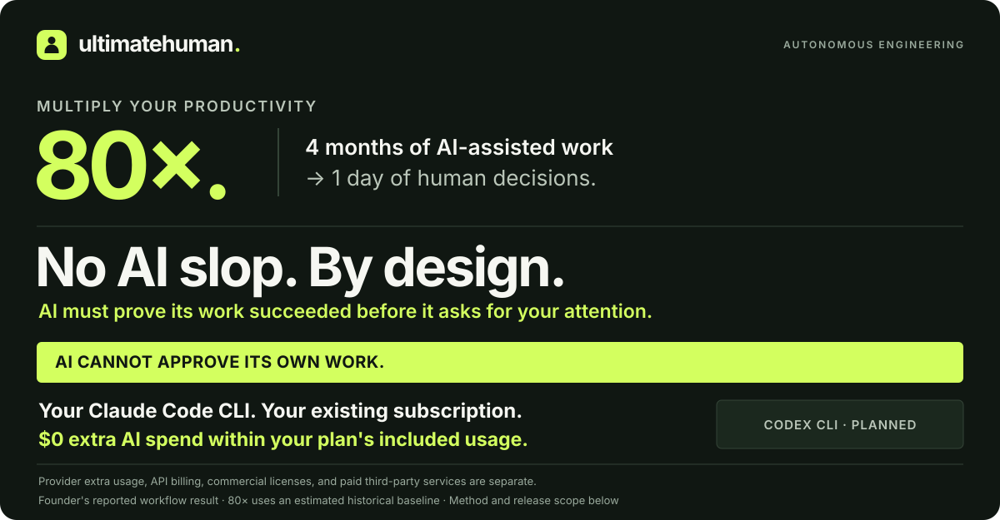
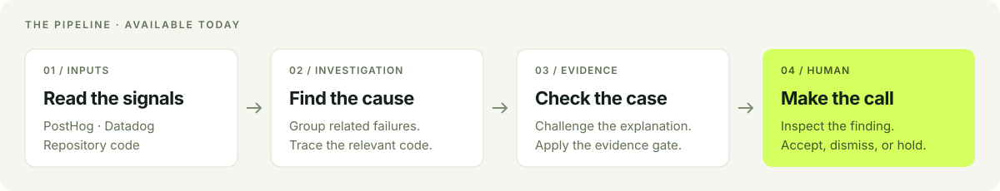
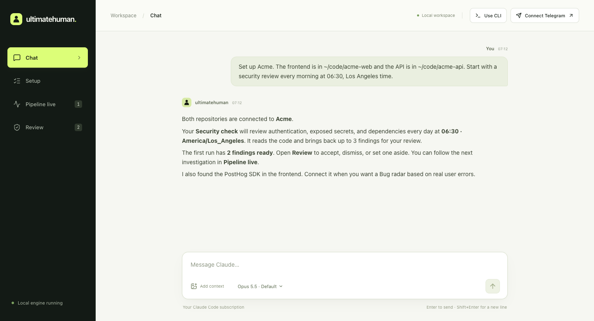
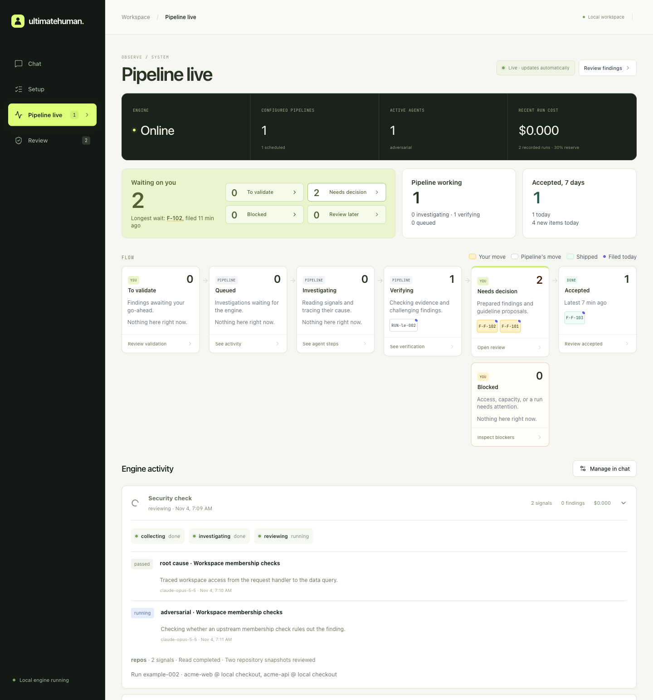
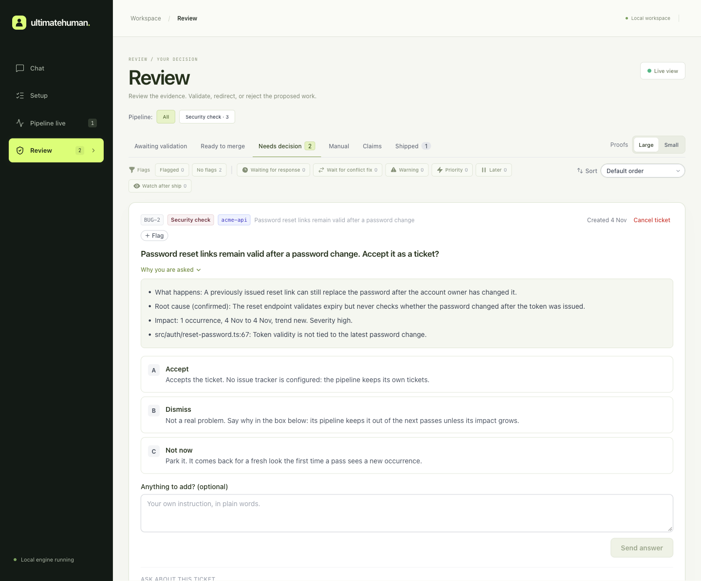
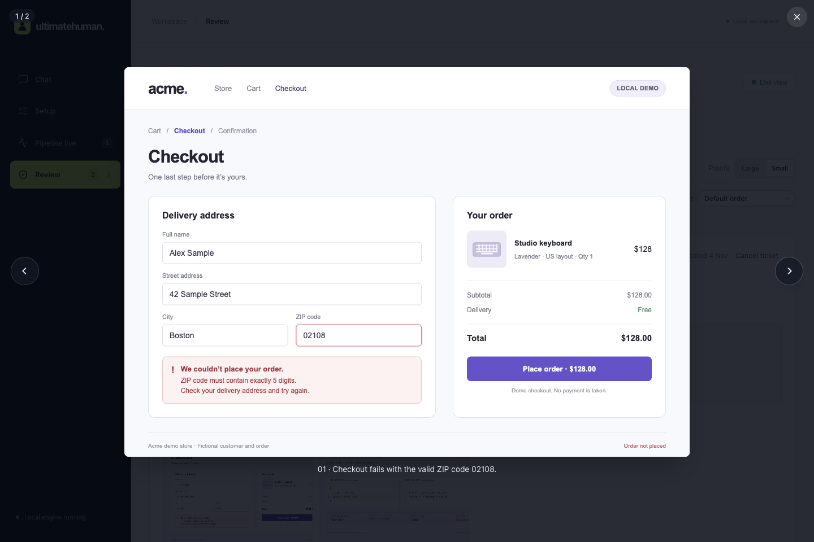

<p align="center">
  
</p>

<p align="center">
  <a href="https://www.npmjs.com/package/ultimatehuman"></a>
  <a href="LICENSING.md"></a>
  <a href="https://github.com/vincent38wargnier/ultimatehuman/actions/workflows/check.yml"></a>
</p>

## Multiply your productivity by 80×.

**Four months of AI-assisted work → one day of human decisions.**

That is the result behind ultimatehuman. Vincent reports **about 100 tickets reviewed in 5 hours** in the founding workflow. The **80×** comparison uses 80 tickets at an estimated previous pace of one ticket per workday, compared with one day of human review. It compares human effort, not total engineering time, and is not a benchmark of this npm release.

## No AI slop. By design.

**AI cannot approve its own work.** It investigates the problem, checks the evidence, and brings you a decision. You inspect the case and accept, dismiss, or hold it.

The public release delivers **investigation and human review**. The full workflow extends this to fixes, browser proof, and independent deployed verification; those stages are still being built. Evidence checks reduce unsupported findings; they are not a zero-defect guarantee.

## Your existing CLI. Your existing subscription.

**Runs on your Claude Code CLI. $0 extra AI spend within your subscription's included usage.** No second AI subscription or separate model API key is required.

The engine reuses your local Claude Code login for chat and investigations. Work counts toward your existing plan's limits. Provider extra usage or a separately configured API key can incur charges. [Claude's billing explanation](https://support.claude.com/en/articles/12304248-manage-api-key-environment-variables-in-claude-code)

Commercial licenses for ultimatehuman and any paid tracking or hosting services are separate. [License details](LICENSING.md)

| CLI | Status |
| --- | --- |
| **Claude Code** | Available — reuses your local login |
| **Codex CLI** | Planned — not implemented in this release |

## Start here

```sh
npx ultimatehuman@latest
```

Run it locally. Set it up through chat. Watch **Pipeline live**. Make the call in **Review**.

Requires **macOS or Linux**, **Node.js 22.13+**, **Git**, and **Claude Code installed and signed in**. [Install Node.js](https://nodejs.org/en/download) · [Set up Claude Code](https://code.claude.com/docs/en/quickstart)

Free for personal use and internal business use with fewer than 2 employees. Business use with 2 or more employees requires a paid license. [License details](LICENSING.md) · [Contact Vincent](mailto:vincent@vw-coding.com)

The CLI verifies your existing Claude account, starts the local engine, and opens your browser. **Continue in Chat.** Chat and investigations use your configured Claude Code account and count toward its usage limits.

Start with something like:

> My project is Acme. The frontend is in ~/code/acme-web and the API is in ~/code/acme-api. Help me set up the first pipeline.

1. **Connect the project.** Chat inspects your repositories and identifies frameworks, tests, and tracking tools.
2. **Connect the signals.** If you already use PostHog or Datadog, connect it through a private credential form inside chat. No tracking yet? Start with a code-only Security check, or ask for help adding tracking.
3. **Run one pipeline.** Review its scope and schedule, then ask it to run. Follow the investigation in **Pipeline live**.
4. **Make the decision.** Open a finding in **Review**, inspect its evidence, and accept, dismiss, or set it aside.

Run the same command again to reopen your workspace. Your repositories, settings, and conversation are preserved.

## How the evidence reaches you

Your production data tells you where the product is breaking. ultimatehuman connects those signals to your code and prepares a case you can inspect.

| Step | What happens |
| --- | --- |
| **01 · AI investigates** | Groups related signals, reads the relevant code, and explains the suspected cause. |
| **02 · The pipeline requires evidence** | Challenges the explanation and checks the configured evidence requirements before filing a finding. |
| **03 · You decide** | Inspect the problem, impact, and evidence. Accept, dismiss, or hold the finding. |

If the evidence does not hold up, a run can finish without a finding. Accepting one records your decision; it does not automatically merge or deploy code.

<p align="center">
  
</p>

## One conversation. The whole system in view.

| Workspace | What you do there |
| --- | --- |
| **Chat** | Connect repositories and sources, create pipelines, set schedules, and change guidelines in plain language. |
| **Setup** | See which repositories are wired, which sources are connected, and what to set up next. |
| **Pipeline live** | Follow queued work, active investigations, evidence checks, blockers, and decisions across the system. |
| **Review** | Read the problem, impact, and supporting evidence. Record your decision and export an issue draft. |

The browser, terminal, and optional Telegram connection share one conversation. Chat offers the models available in your installed Claude Code, with **Opus 5.5** as its default. Changing the chat model leaves pipeline models unchanged.

## See the product

Screenshots use fictional Acme repositories and sample data. Chat and Pipeline live show the shipped `0.1.0` interface; the Review example below also illustrates its screenshot viewer with demo attachments.

### Set up through chat

Tell it which repositories belong to your project and when to investigate. Chat explains the scope, identifies existing tracking tools, and guides you to the first review.



### Follow the pipeline live

See what is running, what is being checked, and what needs your decision. Expand a run to inspect its individual steps.



### Make the decision

**A valid ZIP code. A failed checkout. An explanation you can inspect.**

In this example, a shopper enters `02108`. The checkout converts it to `2108`, and the API rejects the order. The ticket brings together the cause, code reference, and two screenshots: the checkout failure and the request behind it.



The original Review viewer opens each screenshot at full size, with navigation between the evidence images.



[View the checkout screenshot](docs/assets/screenshots/checkout-failure.png) · [View the request trace](docs/assets/screenshots/checkout-request.png)

**Example scope:** these attachments come from a local demo. The current release does not yet connect screenshot attachments to review tickets or capture them automatically. The shipped release records investigation decisions; automated fixes and merges are future stages. [Screenshot details](docs/assets/screenshots/README.md)

## Start with the tools you already use

| Input | What it unlocks today |
| --- | --- |
| **PostHog** | Investigate errors and user behavior with event and session evidence. |
| **Datadog** | Investigate recurring failures using error logs and events. |
| **Git repositories** | Connect a finding to its code; investigate security risks without a tracker. |
| **Findings API** | Submit a finding from another tool into the same review workflow. |

Detection is not connection: finding an SDK in your repository does not grant access to its data. Chat opens a credential form, provides setup guidance, and checks access before treating a source as connected. Keys are saved on your machine, outside the chat transcript.

Two pipeline templates are included. You can change their scope, schedule, timezone, models, and guidelines through chat.

| Pipeline | Investigates | Default schedule | Findings per run |
| --- | --- | --- | --- |
| **Bug radar** | User-facing bugs from connected tracking data | Daily, 07:00 | Up to 5; at least 2 evidence items |
| **Security check** | Exposed secrets, dependencies, and authentication/authorization patterns | Daily, 06:30 | Up to 3; at least 1 evidence item |

Schedules use the engine's timezone unless you specify one. These are limits, not quotas. A quiet or inconclusive investigation may produce no tickets.

## Your machine. Your account. Your judgment.

- **Local workspace.** The engine, dashboard, configuration, and findings run on your machine. Relevant code and evidence are sent to your configured AI provider during analysis; connected sources are queried over their APIs.
- **Read-only investigations.** Autonomous pipelines inspect sources and code. Interactive chat can run shell commands or edit files with approvals shown in the conversation.
- **Capacity for your own work.** The engine reserves 30% of the account's usage window by default and can pause work when capacity is exhausted.
- **Explicit outcomes.** Accepting a finding records your decision locally. You can export a Markdown issue draft; acceptance does not merge or deploy code.

## Where this is going

The goal is autonomous engineering with a human decision at its center:

**Discover → Plan → Fix and test → Human decision → Verify**

This first public release delivers the **investigation and review** part: chat setup, real source connections, scheduled pipelines, evidence checks, live progress, and local decisions.

Autonomous fixes, browser proof of a fix, pull-request delivery, and deployed verification are the next stages. Sentry collection, automatic database preparation, and direct issue publishing are also not included in this release. [Read the pipeline concept](docs/concept-and-pipeline.md) · [See the roadmap](ROADMAP.md)

## A few useful commands

| Command | Purpose |
| --- | --- |
| `npx ultimatehuman@latest` | Start or reopen the browser workspace |
| `npx ultimatehuman@latest chat` | Continue the shared conversation in your terminal |
| `npx ultimatehuman@latest doctor` | Check account access and configuration |
| `npx ultimatehuman@latest service install` | Keep the engine running after login/restart |
| `npx ultimatehuman@latest stop` | Stop an engine launched without the background service |

Prefer a persistent command? Run `npm install -g ultimatehuman`, then `ultimatehuman`.

### Questions

**Do I need a separate API key for Claude?** No. The normal installation uses your existing Claude Code login. Tracker credentials are separate and are requested only when connecting a source.

**Does it add an AI bill?** With subscription login, work within your plan's included usage has no additional AI charge. Your existing limits still apply; provider extra usage and API-key billing are separate. ultimatehuman's commercial license and third-party services may also carry costs.

**Can I use Codex CLI?** Not yet. The current installer, chat, and pipeline runner require Claude Code. Codex support is [planned](ROADMAP.md#v2-not-scheduled).

**Can one project include several repositories?** Yes. Tell chat which repositories belong together, such as your frontend and API.

**Do I need PostHog or Datadog?** No. The Security check works from repository code. Production bug investigations need a connected source with relevant data.

**Does it run while my laptop is closed?** The machine must be awake and online. Use an always-on machine for continuous operation. The optional background service handles restarts, not sleep.

**Where is my data?** In `~/.ultimatehuman` by default. Use `ULTIMATEHUMAN_HOME` to select another workspace. [Configuration and development](docs/development.md)

## Build with us

This is an early source-available release. Useful bug reports include the installed version, the steps you took, and what you expected. Remove credentials and private project data before posting.

[Report a problem](https://github.com/vincent38wargnier/ultimatehuman/issues) · [Contribute](CONTRIBUTING.md) · [Run from source](docs/development.md) · [Agent installation guide](docs/agent-install.md)

## Talk to the founder

Questions, company installation, or commercial licensing: **[vincent@vw-coding.com](mailto:vincent@vw-coding.com)** — Vincent Wargnier, VW Coding.

## License and commercial use

Source-available under the [ultimatehuman Community License 1.0](LICENSE). This combines PolyForm Noncommercial 1.0.0 with an additional permission for qualifying small businesses. It is a custom license, not MIT or an OSI-approved open-source license.

| Use | Terms |
| --- | --- |
| Personal and other permitted noncommercial use | Free |
| Internal business use with 0 or 1 employee | Free under the small-business permission |
| Business use with 2 or more employees | Separate paid commercial license required |
| Selling or hosting ultimatehuman itself for customers | Separate commercial license required |

Count employees across the business and its controlled group, not just ultimatehuman users. Part-time employees count as one person; founders count if they are employees. Work on a client's projects uses the client's headcount too. If the business grows to 2 employees, obtain a commercial license before continuing business use. The underlying license's specified nonprofit, educational, research, and government permissions remain available.

[Contact Vincent Wargnier for a commercial license or company installation](mailto:vincent@vw-coding.com).

Previously granted rights remain valid, including the earlier Apache-licensed revisions. [Eligibility examples, previous versions, and third-party licenses](LICENSING.md)
