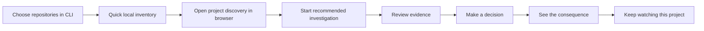

# CLI-to-decision refinement plan

Proposed product and implementation plan, reviewed on 31 October 2026 against `walkthrough-v2.pdf`, the nine-slide autonomous engineering pitch deck, and the current repository. This document proposes changes; it does not describe newly implemented functionality.

## 1. Product objective

Make the first session demonstrate three things:

1. The system understands this project well enough to recommend relevant work.
2. It can investigate something useful and substantiate its conclusions.
3. A human decision produces a clear, observable consequence.

Open the browser as soon as at least one selected repository is accessible, the local engine is healthy, and a resumable project session exists. A short local inventory can happen before that handoff. Model-based discovery, integration setup, and substantive investigation should continue in the UI.

The first UI should be a project discovery workspace. The returning user's home should be Review. Onboarding must eventually lead into the same review component used for daily work.

The current product can complete a finding-to-decision-to-issue loop. Delivering the deck's tested-fix promise also requires implementation, execution isolation, proof collection, and release integrations. Treat those as a separate engineering milestone with the same review experience.

## 2. What changes from the current walkthrough

| Current walkthrough | Proposed experience |
| --- | --- |
| Clone and build ultimatehuman itself | Run a published npm package with the built CLI and UI |
| Ask for tracker keys before showing value | Inspect the project first; connect a source when it unlocks a recommended investigation |
| Offer to add Sentry during installation | Offer observability setup later from the project page |
| Ask for staging, issue destination, and notifications during the wizard | Request each when the user reaches the capability that needs it |
| Land on a Bronze grade and skipped setup items | Land on the project, discovered capabilities, and a recommended next action |
| Ask Chat what is missing | Show the missing requirement and recovery action inline |
| Return to the terminal for service installation and credentials | Provide UI management backed by the local engine; retain equivalent CLI commands |
| Navigate to Runs and manually start a pass | Start the selected first investigation directly from discovery |
| Recorded run ends with zero signals from zero sources | Distinguish unavailable coverage from completed analysis with no convincing findings |

The walkthrough records 13 actions and estimates 5–7 minutes of hands-on work. Its final recorded pass did not have a connected tracker. That is evidence of a disconnected first-use journey, not evidence that every installation produces no findings.

## 3. Target journey



Proposed usability targets, to measure rather than advertise as guarantees:

| Milestone | Initial target | Conditions |
| --- | --- | --- |
| Visible startup feedback | Within 2 seconds of CLI process start | Excludes npm download |
| Browser handoff | Within 30 seconds of local repository selection | Excludes cloning and authentication delays |
| Useful discovery summary | Within 60 seconds of repository availability | Bounded inspection; partial results can appear earlier |
| First bounded investigation outcome | Aim for 2–5 minutes on representative small projects | A finding, honest coverage report, or explicit blocker; no finding guarantee |
| Prepared case understood | Within 30 seconds of opening it | Validate through user testing |
| Ordinary first-run decisions | Repository choice and one investigation start | Additional questions only for actual access or scope ambiguity |

Report wall-clock time separately from active human time. Report cold installs, remote clones, large repositories, and missing authentication separately.

## 4. CLI contract and browser handoff

Proposed published entry point:

```bash
npx ultimatehuman@latest
```

This is a release target. The current CLI package is private and its no-command path prints help. Packaging and dispatch changes are required. `npx` can fetch a package into npm's cache and execute its binary; it does not establish a durable application runtime by itself. See [npm's npx documentation](https://docs.npmjs.com/cli/v11/commands/npx).

The CLI should:

1. Detect required runtime tools and available model authentication.
2. Offer the current Git repository as the default, or accept a local path or Git URL.
3. Allow multiple repositories, with one clearly selected first project. Do not require users to enumerate their entire organization.
4. Reuse existing Git authentication. Clone remote repositories into a managed location and show real clone progress. Keep an inaccessible repository from blocking discovery of accessible repositories.
5. Read a bounded inventory of manifests, workspace structure, test configuration, CI files, and integration references.
6. Persist a project/discovery session, start or reuse the engine, and open an authenticated deep link to that session.
7. Print a working fallback URL and a command to reopen the experience.

Example terminal copy, illustrative rather than observed output:

```text
Project: acme/storefront
Repository accessible. Reading project structure…
Web application and test configuration detected.
Opening your project workspace. Discovery will continue there.
```

The quick inventory only reads files; running application scripts belongs to an explicitly enabled execution capability. If AI authentication is missing, the browser can still show the inventory and the exact sign-in step.

Fresh invocation starts onboarding. Existing invocation resumes the project or opens Review without overwriting configuration or starting duplicate work. Preserve a non-interactive CLI path and provide a proposed `--no-open` mode for headless use, with instructions for accessing a loopback UI over an SSH tunnel.

Keep durable runtime files, state, and any background service independent of an npm cache entry. Show whether closing the terminal or rebooting will stop work, according to the actual process mode.

## 5. Discovery should produce a useful recommendation

Separate three operations:

| Operation | Purpose | Output |
| --- | --- | --- |
| Local inventory | Identify what is actually present | File-backed facts |
| Capability discovery | Determine which supported investigations can run | Ranked recommendations and prerequisites |
| Investigation | Evaluate a particular problem | Evidence-backed finding or a scoped coverage report |

A framework inventory alone is not the first substantive result.

Discovery should record:

- Project and repository identity, branch/revision, and application boundaries.
- Frameworks, languages, and manifest locations.
- Tests and CI configuration that exist; whether execution has actually been verified.
- Integration SDKs that are detected; separately, credentials verified and data available.
- Candidate product areas such as authentication or payments, marked as inferred until supported.
- Available pipelines, missing prerequisites, unsupported capabilities, and the next useful action.

Use distinct labels: **Detected**, **Connected**, **Data available**, **Tested**, **Needs setup**, and **Unavailable in this version**. Each claim should link to its source or verification check.

Recommend at most three relevant pipelines. Highlight one as the best starting point. Rank by usable evidence, likely relevance, expected effort, and implementation availability. Do not treat a speculative business-impact score as measured fact.

Example recommendation logic:

| Project evidence | Recommendation | Availability condition |
| --- | --- | --- |
| Accessible source code, no tracker | Repository security review | Existing `security-check` template and repo source |
| Connected PostHog or Datadog with relevant data | Investigate user-facing failures | Successful probe and usable collection |
| Tracker SDK present, credentials missing | Connect the detected source | A functioning connector exists |
| Tests and a staging URL present | Browser verification opportunity | Future execution and evidence harness implemented |
| User supplies a known issue or reproduction | Focused issue investigation | Issue-intake implementation available |

The current Sentry plugin has an unimplemented probe and collector. Detection must therefore not produce a working “Connect Sentry and investigate” promise until the connector is completed.

The repository-only fallback already has an implementation base: `security-check`, `repo-source.ts`, and the generic executor. Improve its onboarding selection before building a generic code-quality product. A recommendation must not assert that a vulnerability exists before investigation.

Preserve the original installer, template defaults, and saved pipeline behavior. The UI may recommend a template and explain its schedule, but must not replace its defaults with a manual, one-finding pipeline. Editing saves only changed fields; naming a paused pipeline must not enable it or alter its sources, repository scope, model overrides, validation gate, or evidence rules.

## 6. First browser screen

Title: **Your project is connected. Here is where we can help.**

Above the fold:

1. Project identity and selected repository/application scope.
2. A short, factual project summary that fills in as discovery runs.
3. The recommended first investigation, why it fits, and the evidence it can use.
4. A primary **Start recommended review** action and secondary **Choose another focus** action.

The start action should summarize scope and model-account usage in one short sentence. Expose the selected effort limit and cancellation control; retain deeper policy settings elsewhere.

For a repo-only installation, suggest a focused repository security review. If a supported tracker is already connected, investigate the strongest available signal. If one credential would substantially improve the first run, present that connector in place while preserving the repo-only choice.

Use the selected project session throughout discovery and investigation. Do not reopen a generic setup dashboard or ask for the same repository twice. Avoid making the first session a tour of all features.

## 7. Investigation progress and outcomes

Keep the current investigation visible in the project workspace. Show the selected objective, real milestones, elapsed time, scope, and measured counts where available.

Useful milestone language includes “Reading recent error groups,” “Checking the relevant code,” “Testing alternative explanations,” and “Preparing evidence.” Only show a milestone when the engine actually performs it. The current read-only radar must not claim to run application tests.

Hide raw prompts, internal agent routing, and token diagnostics behind technical details. Show a concise explanation of completed work instead.

Surface the first reviewed finding as soon as it passes the actual evidence checks. Remaining work can continue. Preserve focus and scroll position while updates arrive; do not navigate away when the run completes.

Support these outcomes explicitly:

| Outcome | User-facing treatment |
| --- | --- |
| Finding ready | Open a focused evidence-and-decision case |
| No convincing finding | State what was checked and the limits of that coverage |
| No source data | Say the investigation lacked data; offer the appropriate connection or repo review |
| Authentication failure | Preserve progress and show the exact reconnection action |
| Capacity limit | Show the checkpoint, known resume time, and queue state |
| Effort budget reached | Show partial coverage and let the user extend the investigation |
| No browser runtime/staging | Show code evidence without claiming behavior was reproduced |

A separate, labeled sample project can demonstrate the complete future workflow. Never mix sample results into the user's real review queue.

## 8. Review is the centerpiece

Use a compact queue beside one focused case on desktop. The case must answer:

1. What problem matters, and to whom?
2. What does the evidence establish?
3. What cause or change is proposed?
4. What remains uncertain?
5. What decision is requested, and what will happen next?

Show the outcome title, project, severity, observed impact, evidence provenance, and verification state without expanding a hidden rationale panel. Treat unknown impact as unknown rather than zero.

Case content:

| Area | Content |
| --- | --- |
| Summary | Problem, proposed outcome, concise recommendation |
| Evidence | Source links, code references, test logs, screenshots or replay when available |
| Changes | Diff and explanation for actual proposed fixes |
| Limits | Incomplete checks, uncertainty, assumptions, and remaining risks |
| History | Investigation, verification, human decision, and delivery events |
| Action area | One primary consequence-specific action and clear alternatives |

Evidence must identify the source, capture time, repository/revision, scenario, and environment where relevant. Distinguish a model's recommendation, deterministic checks, executed tests, and independently performed verification. Do not label an adversarial text review as independent browser testing.

For before/after proof, compare the same scenario against identified baseline and candidate versions. Let users enlarge screenshots, view logs, and inspect the diff. Re-run relevant checks if the proposed revision changes; approval of one revision must not silently approve another.

Current finding actions can be **Create GitHub issue**, **Keep as local finding**, **Dismiss**, and **Review later**, according to the implemented backend. Without write access, expose an honest issue preview and a connection action. Implement any missing local-accept or deferral behavior before showing those buttons.

The full product can add **Approve merge**, **Request refinement**, and **Reject change**. If approval also starts release, name that consequence explicitly. A refinement is a bounded instruction that resumes preparation; it should not require the reviewer to operate agent stages.

After a decision, show a durable receipt and a link to its consequence. Preserve a path to the next case. Prevent duplicate submissions and stale decisions; display ownership and concurrent updates for shared-team operation.

Keep statuses distinct: finding accepted, issue created, fix preparing, evidence ready, approved, merged, deployed to staging, deployed to production, production verified, rejected, and deferred. Show only states supported by the current product. A filed issue is never a shipped fix.

## 9. Daily navigation and management

Use one application shell, routing model, sidebar, and settings destination.

**Scope constraint:** this refinement improves UI/UX. Existing capabilities, CLI commands, configuration controls, templates, and original deep links must remain available. Simplifying presentation is not authorization to change execution policy, remove workflows, or override the user's settings.

Keep **Pipeline live** as the first navigation item and the default view once a pipeline is configured.
Its original flow visualization is central to understanding the system; configuration cards do not replace it.
Fresh workspaces open Projects for repository discovery. Preserve the existing live-page URL.

| Destination | User's question | Main content |
| --- | --- | --- |
| Pipeline live | What is the overall system doing right now? | Flow, queued and active investigations, agent steps, verification, blockers, human decisions, recent cost |
| Review | What needs my judgment? | Prepared cases, recommendations, evidence, exceptions |
| Projects | What is understood and connected? | Repositories, applications, source mappings, environments, coverage |
| Pipeline settings | What work have I delegated, and under what rules? | Objectives, scope, sources, schedule, pause/resume, recent results |
| Results | What happened after my decisions? | Issues, merges, deployments, verification, recurrence |
| Settings | What are the boundaries? | Guidelines, connections, model account, usage, service, team access |

Keep a persistent project switcher. Provide All projects for reviewers with multiple projects. Chat is a contextual panel available from these pages; it inherits the current project or case and does not replace the shell.

### Projects

Support one product with several repositories and a monorepo with multiple applications. Show which source account/project feeds each project, which repository receives an issue or change, and which environment is used for verification. Ask users to resolve genuinely ambiguous mappings.

Add repository, connect source, verify connection, change environment, and remove project should be normal forms. Retain CLI equivalents for automation.

### Pipeline live and pipeline settings

The live page subscribes to engine events and refreshes while open. Scope the complete view with
the shared project switcher. Show active model calls, their steps, the actual queue, and explicit
blockers; an idle configured pipeline is not queued work. Link flow nodes to their finding,
guideline proposal, or run details. Keep unavailable historical coverage distinct from zero activity.

Retain the installer’s existing account detection and live verification. Reuse a working login
automatically; an expired session is a reconnection problem, not incomplete installation.
Preserve projects and pipelines while reconnecting, and make **Check again** verify the same
account and environment used by the engine.

Define a pipeline as a repeatable objective plus sources, scope, and operating rules. Discovery, implementation, testing, and verification are stages inside that work; avoid using the same name for a template, a run, and the review queue.

Each pipeline card shows its goal, project, status, last result, next run, and an appropriate action. Differentiate running, queued, scheduled, paused, blocked, and awaiting a human. The current serialized executor must not look like several investigations are running simultaneously.

Basic editor: goal, repositories/applications, connected sources, schedule with timezone, and usage limit. Advanced editor: raw cron, evidence thresholds, signal types, model overrides, and instruction internals. Generate internal IDs automatically.

### Guidelines and settings

Lead guidelines with priorities, scope exclusions, expected behavior, and escalation rules. Keep version history, diffs, and restoration. Save drafts per project/pipeline and preserve them across tab changes. Show which version will affect the next run and whether active work retains its original version.

Separate connection health, model capacity, service uptime, and analysis coverage. Remove Bronze/Silver/Gold/Platinum from the main product hierarchy. Enabling Telegram should not imply that analysis or verification became stronger.

### Results

Show actual delivered outcomes and remaining work. Record reviewer time and cost where measurable. If displaying time saved, label its estimation method. Do not turn the deck's historical productivity claim into an automatic account-level claim.

## 10. Visual design

Preserve the existing restrained typography and card styling while strengthening hierarchy.

- Use a quiet neutral application background, white working surfaces, dark text, and one consistent brand accent.
- Borrow the deck's emphasis on the human decision. A restrained lime accent can identify that moment; keep semantic success, warning, and failure colors separate.
- Give evidence and the requested decision more space than IDs, metadata badges, and agent details.
- Use a visible case selection, compact queue, large evidence viewer, and predictable action placement.
- Prefer factual status labels to decorative progress bars or ungrounded percentages.
- Use subtle transitions for incoming evidence and completed decisions. Preserve reading position.
- Support keyboard navigation, visible focus, labeled controls, readable contrast, reduced motion, and zoomable evidence.
- On mobile, open one case at a time, keep the action area reachable, and preserve access to evidence before commitment. Queue navigation should not require squeezing a desktop layout into the screen.

Prepare designed states for discovery in progress, discovery blocked, recommendations ready, investigation running, finding ready, no finding, budget pause, stale evidence, submission failure, and successful decision. These states determine perceived quality as much as the happy-path layout.

## 11. Retention after the first useful result

Offer **Keep watching this project** after the first substantive outcome and decision, where one is available.

In one small setup surface, choose schedule, usage limit, notification destination, and background operation. Show what is running now, what runs next, and how to pause it. Do not require notifications to consider the project usable.

Notify on prepared decisions and material blockers. Link directly to the relevant case. Keep routine retries and agent coordination in the engine. Escalate a concrete judgment or exhausted recovery condition with a concise account of what was attempted.

For the full product, grant preparation authority once within a clear project policy: permitted repositories, isolated branches/environments, effort limits, and the human release gate. Do not require approval of every internal step, and do not reinterpret permission to inspect code as permission to merge or deploy it.

## 12. Delivery sequence and acceptance criteria

| Phase | Deliverable | Acceptance criterion |
| --- | --- | --- |
| A. Trust and common shell | Unified navigation, honest statuses, visible evidence, capability-based controls | No unsupported action in the main journey; source evidence survives the adapter |
| B. Entry and discovery | Publishable npm artifact, repository intake, session handoff, discovery recommendations | Fresh user reaches a relevant browser workspace without configuring schedules or notifications |
| C. First complete supported loop | One-shot investigation, focused finding review, working decision, outcome receipt | Repo-only and connected-source users can complete a supported decision without operator help |
| D. Ongoing management | Projects, source mapping, editable pipelines, safe drafts, background operation, Results | User can keep work running, pause it, and understand its real state |
| E. Deck-level delivery | Isolated fix preparation, executable tests, browser proof, human approval, release and verification | One real problem reaches a tested, approved change and observable delivery outcome |

Phases A–C form the first coherent release slice. Phase D makes that slice usable over time. The full autonomous engineering positioning requires Phase E; a visual redesign alone does not satisfy it.

### Repository implementation map

| Area | Existing starting points | Required change |
| --- | --- | --- |
| npm entry | `packages/cli/package.json`, `packages/cli/src/index.ts`, `scripts/build.mjs` | Package UI assets, adjust publishing/entry behavior, test installed artifact and durable service paths |
| CLI handoff | `packages/cli/src/commands/init.ts` | Shorten wizard; persist discovery session and open UI early |
| Discovery | `packages/core/src/setup/scan.ts` | Expand inventory and add supported capability recommendations with provenance |
| Repo-only investigation | `packages/core/src/pipelines/templates/security-check.ts`, `packages/core/src/pipelines/repo-source.ts` | Expose the original Security check template without requiring a tracker or overriding its defaults |
| Shared shell | `packages/dashboard/src/main.tsx`, `packages/dashboard/src/App.tsx`, `packages/dashboard/src/verbatim/main.jsx` | Consolidate navigation and page mounting |
| First-use workspace | `packages/dashboard/src/pages/Setup.tsx` | Replace grade-first layout and timed redirect with persistent discovery and review state |
| Evidence and outcomes | `packages/dashboard/src/verbatim/data-provider.js`, `packages/core/src/cockpit.ts` | Preserve evidence and semantics; separate issue creation from delivery |
| Pipeline management | `packages/dashboard/src/pipelines/PipelinesPanel.jsx`, `packages/core/src/pipelines/schema.ts` | Basic/advanced editor, explicit project/repo scope, timezone and limits |
| Instruction editing | `packages/dashboard/src/teach/InstructionsPage.jsx` | Plain-language guidelines and preserved drafts |
| Connector readiness | `packages/plugins/sentry/src/index.ts` and other connector manifests | Declare and verify implemented capabilities |
| Autonomous fixes | New execution, proof, approval, and release services | Implement real end-to-end behavior before exposing actions |

### Data and API dependencies

Add explicit project identity and repository/application/source associations. The current pipeline schema does not have a repository selector, and repo code contexts come from global configuration. Enforce project scope in execution and output routing; a UI filter alone is insufficient.

Persist discovery facts, recommendation rationale, source readiness, and session state. Keep the first investigation tied to its project and selected recommendation. Avoid deriving first-use completion from whether any unrelated run has ever finished.

Model backend-supported actions, evidence versions, execution state, and decision results explicitly. Record approvals against a particular case and proposed revision. Stream durable milestones and allow reconnecting clients to reconstruct the current state. Keep commands idempotent so refreshes, retries, and double-clicks do not duplicate runs, issues, or approvals.

Before Phase E, define test deployment versus production release and the behavior of a failed post-release check. Support bounded repair/escalation and rollback where the integration actually supports it. Keep approval, merge, deployment, and verification observable as separate events.

## 13. Validation and measurement

Test the packaged application in clean environments, not only from the development monorepo. Cover supported operating systems, missing model login, remote private repositories, browser-opening failure, engine restart, occupied ports, expired login links, and interrupted sessions.

For the user journey, cover a repo-only project, a connected source with useful signals, a connected source with no relevant data, unsupported connectors, large monorepos, multiple projects, exhausted model capacity, and stale or unavailable proof.

Use a small initial group of engineers unfamiliar with the product. Ask them to connect a project, understand a recommendation, inspect evidence, make a decision, and explain what happened afterward. Evaluate comprehension and confidence, not just completion.

| Measure | Why it matters |
| --- | --- |
| Time and abandonment before repository access | Installation and authentication friction |
| Time to useful discovery | Immediate project relevance |
| Time to first substantive outcome | Actual first-use value |
| Percentage reaching an informed decision unaided | Workflow clarity |
| Findings judged useful; dismissal reasons | Investigation quality |
| Reviewer comprehension of evidence and uncertainty | Decision quality |
| Active human time per accepted outcome | Alignment with the deck |
| Monitoring enabled and next-session return | Ongoing value |
| Failed verification, rework, and recurrence | Reliability of delivered changes |

Record milestone timestamps locally by default. Any shared product analytics should avoid code, credentials, and raw evidence and have an explicit collection policy.

## 14. Replacement walkthrough

The main demonstration should show a supported complete journey:

1. Run the npm command.
2. Choose a repository.
3. Watch the project workspace appear with grounded discoveries.
4. Start its recommended investigation.
5. Open a real result and inspect its evidence.
6. Decide and see the exact consequence.
7. Enable ongoing watching if desired.

Move credential troubleshooting, service details, and advanced settings into short separate guides. Show a successful real case in the primary demonstration; cover the honest no-finding outcome separately. Label recorded examples and future prototypes clearly.

For the deck-level demonstration, the result must include an actual proposed change, matching before/after proof, a human approval, and the observed delivery or verification outcome. That completes the promise the presentation makes.
