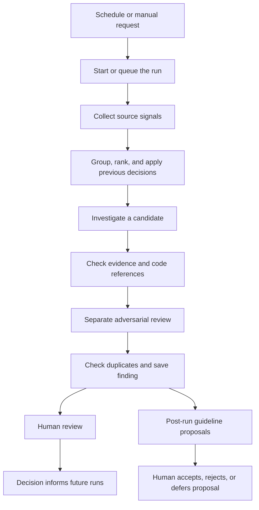
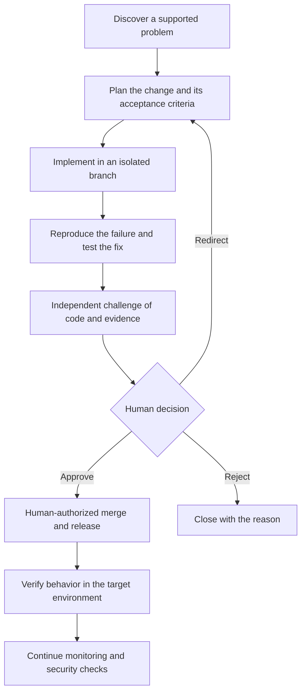

# ultimatehuman: concept and pipeline

ultimatehuman investigates engineering problems and brings the human a decision supported by evidence. The long-term goal is to prepare, test, and independently challenge code changes so the engineer can approve, redirect, or reject the work without managing the agent loop.

The experience has three parts: **Chat to set things up, Pipeline live to see the work, and Review to make decisions.** Browser chat, terminal chat, and Telegram use the same conversation and Claude account.

This guide describes the current implementation and distinguishes it from the full autonomous-engineering workflow in the pitch deck.

## 1. What works today, and where it is going

| Capability | Current implementation | Full product direction |
| --- | --- | --- |
| Setup | Claude-backed chat; repository discovery; connection checks | Guided setup through the same conversation |
| Investigation | Read-only analysis of code and connected signals | Continuous discovery and prioritization |
| Evidence review | Deterministic checks and a separate AI reviewer | Also challenge reproductions, code changes, and test results |
| Human decisions | Validate, accept, dismiss, defer; review guideline proposals | Approve, redirect, or reject a prepared change |
| Code changes | Investigation does not edit the project | Prepare an isolated fix and pull request |
| Testing | Inspect available evidence and test tooling | Reproduce the problem and demonstrate the fix in a test environment |
| Delivery | Local findings and Markdown issue drafts | Human-authorized merge and release, followed by verification |

**Accepting a finding today does not fix the problem, publish a live issue, merge code, or deploy anything.** A suggested fix or reproduction in a finding is a proposal, not proof that the engine executed it.

## 2. First use: account, repository, investigation

### Start from the terminal

The intended published entry point is:

```sh
npx ultimatehuman@latest
```

Until the package is published, use the locally built package or follow the [repository quick start](../README.md#quick-start).

The default CLI checks Claude Code and verifies the configured account with a small real model request before asking for repositories or integrations. It reuses an existing login. If Claude Code is missing, it explains that prerequisite; if login is required, an interactive setup can launch `claude auth login`.

An installed CLI, a saved credential, and a working account are different states. Only a successful check establishes that the account can currently run work. Rechecking a connection must preserve the workspace and its existing configuration.

### Move into chat immediately

The CLI starts or reconnects to the local engine, then opens the browser conversation. This handoff happens before the user needs to understand pipelines or configure a dashboard. With `--no-open`, the conversation can continue in the terminal.

The setup conversation follows this sequence:

1. Ask which project to investigate: a local Git checkout or a Git URL.
2. Inspect tracked files to identify the stack, repository structure, test tooling, and tracking SDKs.
3. Explain what was found and what can actually be investigated.
4. Verify access to a supported source if one is available.
5. Suggest an existing pipeline template suited to the project.
6. Apply the agreed configuration and start a real run.
7. Let the user watch Pipeline live and open findings in Review as they arrive.

The installation directory is context, not automatic permission to add that repository. Detecting a tracking SDK does not mean its service is connected. Detecting a test framework does not mean tests have run or passed.

If the project already uses PostHog or Datadog, chat connects that source first and starts one Bug radar. If there is no supported tracking, it offers to add tracking or run the repository-only Security check. Claude can install requested instrumentation using its native tools, with shell/edit approval handled in chat. Sentry discovery is not a working collector in this build.

## 3. The three user-facing surfaces

| Surface | Purpose | Typical interaction |
| --- | --- | --- |
| Chat | Setup and configuration | “Watch this repository and run a security check each morning.” |
| Pipeline live | System-wide operational visibility | See queued runs, current work, evidence checks, blockers, and decisions |
| Review | Inspect a case and decide | Read evidence, judge the recommendation, validate or dismiss |

Configuration belongs in the conversation: repositories, sources, schedules, scope, guidelines, models, and usage preferences. Existing settings remain available; moving them into chat does not remove engine capabilities or reset defaults.

Chat is backed by Claude CLI, but configuration changes go through validated engine operations. The engine supplies the saved configuration, schema, available templates, and actual operation results. A model saying “connected” is not sufficient; the connection handler must succeed.

Secrets are entered through an in-chat connection form with official key links and required read scopes. The engine verifies access before saving the key locally and continuing setup. Interactive setup has Claude's native shell, file-editing, and web tools; commands and edits that require approval appear in chat. Autonomous investigation passes remain read-only.

### CLI and Telegram

`ultimatehuman chat` resumes the same conversation used by the browser. **Connect Telegram** verifies a bot token and pairs a private chat using an expiring link. Once paired, Telegram messages enter the same serialized conversation queue and can perform the same supported configuration operations.

These are different ways to reach one workspace, not separate installations with separate settings. See [Chat](chat.md) for pairing and command details.

## 4. What a pipeline contains

A pipeline is a saved investigation definition. A **run**, also called a **pass**, is one execution of that definition. A **finding** is a case that survives the evidence checks and is saved for review.

| Part | Meaning |
| --- | --- |
| Mission | What to look for and what qualifies as one useful finding |
| Repository scope | Which connected repositories the investigation may read |
| Sources | Repository code, selected trackers, or configured source plugins |
| Signal types | Which kinds of events the pipeline considers |
| Schedule and timezone | When it runs; manual runs are also supported |
| Lookback window | How far back to collect events and recent changes |
| Admission rules | Which candidates deserve investigation |
| Evidence requirements | Minimum evidence and review policy |
| Models and feature overrides | Optional settings for this pipeline |
| Versioned guidelines | Instructions used by its agents |

Templates are starting points. Adding one copies its values into the workspace; later template changes do not silently replace the user's saved configuration.

### The shipped templates

| Template | Main input | Objective | Default schedule | Minimum evidence items |
| --- | --- | --- | --- | --- |
| Bug radar | Configured trackers and analytics | Explain problems users actually encounter | Daily at 07:00 | 2 |
| Security check | Repository code | Identify a concrete, reachable security problem | Daily at 06:30 | 1 |

Times use the configured pipeline timezone, or the engine's local timezone when none is specified. Both templates initially look back seven days, then normally use a 24-hour window.

Bug radar starts with a two-user admission floor and a configured `maxFindingsPerPass` value of five. Security check has no user-count floor and sets that value to three. A code audit cannot infer how many production users were affected from repository code alone.

Each pipeline has five versioned briefs: `mission`, `collector`, `admission`, `gate`, and `scope`. Chat can edit these with version checks. A run records the instruction version it started with and keeps that version if it pauses and resumes.

## 5. How a current run works



Candidates can stop at any check. A run can finish with no findings and an explanation of what it examined and why candidates were dropped.

### Step 1: trigger and queue

A schedule, onboarding action, or manual request triggers a run. One investigation pass runs at a time across the workspace. Other pipelines wait in a FIFO queue, with at most one queued entry per pipeline. A pass paused for capacity retains its slot.

The run records its pipeline, time window, instruction version, repository context, and progress. It records available commit identifiers; code references are checked against the connected checkout, not an automatically created isolated worktree.

### Step 2: collect signals

Collectors read the configured sources without an AI call. Tracker sources supply events and aggregates. The built-in repository source supplies manifests, recent commits, and sensitive paths for code inspection.

Each source reports its own success or failure. A partial collection must remain visible; if every attempted source fails, the run fails instead of treating that as a clean project.

### Step 3: group and filter candidates

The engine groups related signals into clusters, applies previous human decisions, filters by the admission rules, and ranks candidates. This reduces repeated investigations and unnecessary model work.

For example, an already-open finding can receive updated impact counts instead of becoming a duplicate ticket. A dismissed case normally stays suppressed. Candidates below the configured user floor or outside the investigation budget are recorded as dropped.

### Step 4: investigate the cause

Claude receives the candidate's evidence bundle, the pipeline's briefs, and read access to the scoped repositories. It must produce a structured finding or explicitly return `no_finding`.

A finding describes the symptom, impact, proposed cause, reasoning, references, severity, confidence, reproduction steps, and remaining questions. Where code is available, it can cite relevant files and lines. Where it is unavailable, the explanation must stay within what the observed data supports.

The investigation runner allows read tools. It does not execute project tests, edit files, or deploy the application.

### Step 5: verify the draft mechanically

The deterministic gate checks required fields, evidence identifiers, the minimum number of cited evidence items, evidence URLs, and supplied quotations. It re-finds quotations in the collected material and checks any supplied code pointers against the repository.

These checks establish that references exist. They do not prove that the interpretation is correct, that a vulnerability is exploitable, or that a suggested fix works.

### Step 6: challenge the explanation

A separate AI review step tries to disprove the draft using the evidence and repository context. It looks for alternative explanations, exaggerated impact, unsupported causal claims, and existing code that contradicts the conclusion.

| Verdict | Consequence |
| --- | --- |
| `holds` | Keep the supported draft |
| `partly` | Correct permitted fields and preserve uncertainty |
| `broken` | Drop the candidate |

This is a separate review step, not an independently executed test of a code change. If the review fails or produces an invalid answer, the candidate does not become a finding.

### Step 7: deduplicate and save

The engine checks local fingerprints and dismissal rules, records recurrences, and saves surviving findings. Deduplication currently uses the local store; it does not search all existing GitHub issues.

Findings become available as they are produced. When the optional human validation gate is enabled, the finding receives a pending-validation state.

### Step 8: review the run itself

After the investigation, a retrospective can examine the results, dropped candidates, prior decisions, and guidelines. It may propose changes to a pipeline's instructions.

Those proposals wait for a human decision. The retrospective does not rewrite its own rules automatically. It is optional and can be skipped when there is no useful history or insufficient capacity.

## 6. What the human decides

A useful review answers: what is wrong, what supports that conclusion, what remains uncertain, and what the selected action will do.

| Decision | Effect in the current build |
| --- | --- |
| Validate | Promote a finding waiting at the optional validation gate |
| Accept / file | Record the finding as accepted locally; an issue draft is available |
| Dismiss | Record a reason and suppress the corresponding problem |
| Later | Defer the case; a later occurrence can trigger another investigation |
| Reopen | Return a decided finding to review |
| Apply guideline proposal | Create a new instruction version after checking for conflicts |
| Reject / defer guideline proposal | Keep the current guidelines |

The original cockpit includes broader workflow labels. In this build, a filed or “Shipped” card is not evidence that code was merged or released. The underlying decision and delivery record determine what actually happened.

## 7. What happens on the next run

Human decisions change future investigation behavior:

- **Awaiting a decision:** refresh impact when new occurrences arrive instead of repeatedly investigating the same open case.
- **Dismissed:** suppress the case unless its measured impact meets the escalation rule: at least twice the previous affected-user count and at least two additional users.
- **Deferred:** investigate again when an occurrence is newer than the deferral.
- **Accepted:** investigate a new occurrence as a recurrence; do not assume acceptance fixed the cause.
- **Guidelines changed:** new runs use the new version; already-started runs retain their recorded instruction version.

This feedback loop improves what reaches the human without requiring the human to supervise individual agent steps.

## 8. Capacity, failures, and ongoing operation

The engine shares the configured Claude account with its owner. Before agent steps, it uses available usage readings and estimated step cost to decide whether to proceed. The default reserve is 30%. This is an admission policy based on observed and estimated usage, not a precise spending guarantee.

| Situation | Behavior |
| --- | --- |
| Another pipeline is active | Queue the run |
| Reserve or account limit reached | Save progress, park, and resume around the reset |
| Usage measurement unavailable | Keep it unknown; admit small steps and recheck |
| Claude login no longer works | Verify the connection and recover the account without resetting setup |
| A source fails | Record the failure and expose the coverage gap |
| Evidence is insufficient | Drop the candidate with a reason |
| No candidate survives | Finish with an explained empty result |

Saved checkpoints support resuming parked runs and investigations interrupted during root-cause work. This does not mean every operation is transactional or every in-memory queued request survives a restart.

Schedules require the engine to be running. Installing the optional background service makes it start through the operating system; it is not installed automatically. Ask through chat or use `ultimatehuman service install` when that behavior is wanted.

Configuration, history, run artifacts, and guidelines live in the local workspace, normally under `~/.ultimatehuman`. Claude still receives the context needed for model calls; “local workspace” does not mean inference happens offline.

## 9. The full autonomous-engineering workflow

The pitch deck extends the investigation loop into preparing and proving changes. The following is the product direction, not a claim that the current executor performs these steps:



The review package should contain the outcome, code diff, before-and-after evidence, tests, independent review, known gaps, and the exact consequence of approval.

Deploying a preview or staging build to gather evidence is distinct from a production release. Human approval must refer to the particular change and evidence being reviewed. Merged, deployed, and verified are separate outcomes.

Security checks remain a continuing pipeline and a concern during change review. They should not be postponed until after production release. Failed tests or incomplete verification should hold the change under the configured policy; routine retries belong to the system, while exceptions and product tradeoffs belong to the human.

## 10. Example: a new project with no tracking

This is an illustrative journey, not a claim about a finding in a particular repository.

1. The user launches ultimatehuman. The CLI verifies their existing Claude account and opens Chat.
2. The user supplies a repository. Discovery finds a web application and test tooling, but no verified tracking connection.
3. Chat offers the existing Security check and explains that it analyzes code rather than production incidents.
4. The user starts the check. Pipeline live shows collection, investigation, evidence checks, and adversarial review.
5. Suppose a route appears to lack an authorization check. The investigator cites the handler; the reviewer checks middleware and other guards before accepting that conclusion.
6. If the claim survives, Review presents the evidence and uncertainty. If a guard already protects the route, the candidate is dropped.
7. The user accepts a valid finding locally or dismisses it with a reason. Nothing is silently changed in the repository.
8. Through chat, the user can adjust the schedule, connect tracking, or enable background operation. Subsequent runs respect their decisions.

In the full product, the accepted case could continue into an isolated fix, reproduction, tests, independent review, and a human merge decision. That continuation is planned work.

## Implementation references

| Area | Source |
| --- | --- |
| Installation and account-first handoff | [CLI welcome command](../packages/cli/src/commands/welcome.ts) |
| Shared conversation and supported operations | [Chat guide](chat.md), [action handlers](../packages/core/src/chat/actions.ts) |
| Pipeline fields and defaults | [Schema](../packages/core/src/pipelines/schema.ts), [templates](../packages/core/src/pipelines/templates/) |
| Scheduling and queue | [Pipeline runtime](../packages/core/src/pipelines/runtime.ts) |
| Investigation, checks, recurrence, retrospective | [Pass executor](../packages/core/src/pass/executor.ts) |
| Agent tool restrictions | [Claude runner](../packages/core/src/runner/claude.ts) |
| Capacity admission | [Usage tracker](../packages/core/src/governor/tracker.ts) |
| Human decisions and API | [Engine handlers](../packages/core/src/daemon.ts) |
| Findings from external tools | [Tickets API](tickets-api.md) |
